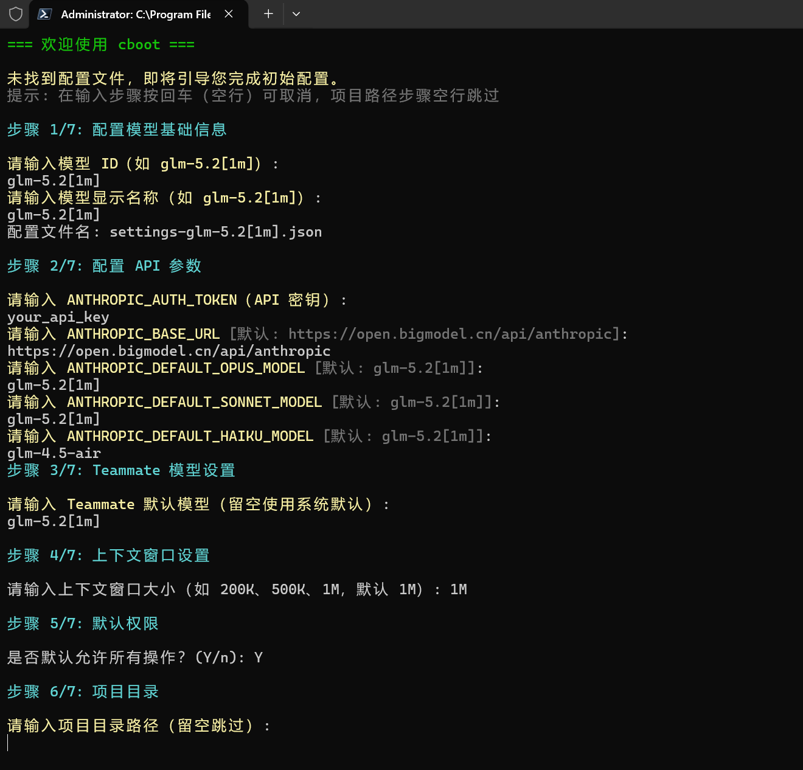
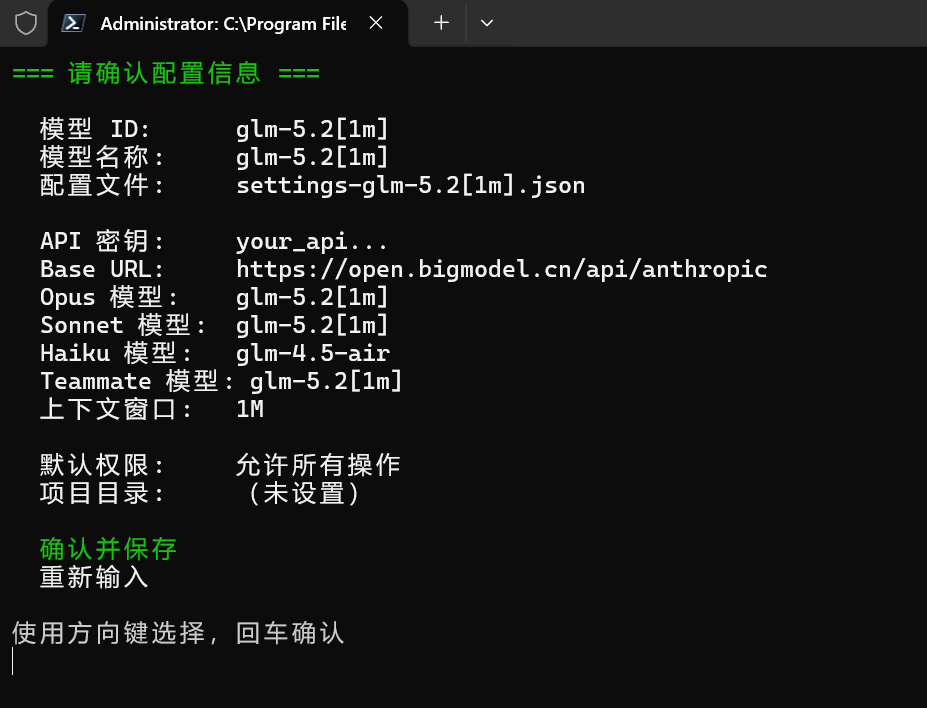

# cboot

[](https://github.com/ph419/cboot) [](LICENSE)

一个 PowerShell 版 Claude Code 交互式启动器，支持多模型切换、项目管理、权限控制和智能排序。

## 功能特性

- **交互式菜单** — 方向键导航，回车选择，ESC 返回
- **多模型支持** — 配置多个 AI 模型，按使用频率智能排序
- **模型管理** — 运行时添加/移除模型，自动生成 settings 配置文件
- **项目管理** — 添加/移除项目目录，自动清理无效路径
- **权限六模式** — `--permission-mode` 六种取值任选：default / acceptEdits / plan / auto / bypassPermissions / dontAsk
- **会话续接** — 主菜单「继续上次会话」一键以 `-c` 续接上次启动（目录 + 套餐 + 续接组合）
- **CLI 参数直启** — `-Model/-Project/-Permission` 跳过菜单直接启动
- **环境体检** — claude 版本比较、settings 废弃键扫描、登录状态检测
- **使用统计** — 记录模型和项目的使用频率，常用项自动排到前面
- **配置修复** — 自动检测配置缺失并提供逐项修复或重新初始化
- **单元测试** — Pester 5 测试套件 + GitHub Actions 双守卫（BOM / PS 5.1 解析）

## 快速开始

### 前置要求

- Windows PowerShell 5.1+
- [Claude Code CLI](https://docs.anthropic.com/en/docs/claude-code) 已安装并可用

### 安装

```powershell
# 克隆项目
git clone https://github.com/ph419/cboot.git
cd cboot
```

### 使用

```powershell
# PowerShell 中运行
.\cboot.ps1

# 或双击 cboot.cmd 直接启动（自动绕过执行策略）
```

首次运行时，cboot 会检测配置是否缺失，并引导你完成初始化或逐项修复。

启动后进入交互式菜单：

```
=== Claude 启动器 ===

主菜单

  使用 Claude
  继续上次会话
  添加模型
  修改配置
  移除模型
  添加项目目录
  环境体检
  移除项目目录
  退出

使用方向键导航，回车选择，ESC取消，H获取帮助
```

操作流程：选择模型 → 选择项目目录 → 选择权限 → 启动 Claude Code

### 使用示例

首次运行时，cboot 会引导你完成初始化配置：

**步骤 1/6 ~ 5/6 — 配置模型信息、API 参数、上下文窗口、权限和项目目录**



**步骤 6/6 — 确认配置并生成文件**




## 配置说明

### claude-config.json

启动器主配置文件：

```json
{
    "models": [
        {
            "id": "glm-5.2[1m]",
            "name": "glm-5.2[1m]",
            "configFile": "settings-glm-5.2[1m].json",
            "contextWindow": "1M",
            "effort": "max",
            "usageCount": 0
        }
    ],
    "defaultModel": "glm-5.2[1m]",
    "defaultPermission": "yes",
    "projects": [
        {
            "path": "C:\\Users\\YourName\\projects\\my-project",
            "usageCount": 0
        }
    ],
    "lastLaunch": {
        "configFile": "settings-glm-5.2[1m].json",
        "modelId": "glm-5.2[1m]",
        "modelName": "glm-5.2[1m]",
            "projectPath": "C:\\Users\\YourName\\projects\\my-project",
        "permissionMode": "bypassPermissions",
        "timestamp": "2026-10-28 12:00:00"
    }
}
```

| 字段 | 说明 |
|------|------|
| `models` | 可用模型列表，每个模型需要 `id`、`name`、`configFile` |
| `models[].contextWindow` | 上下文窗口（`200K`/`500K`/`1M`），编辑菜单「上下文窗口」联动 settings env |
| `models[].effort` | 可选。启动时透传 `--effort`（如 `high`/`max`） |
| `models[].fallbackModel` | 可选。启动时透传 `--fallback-model`，组成回退链 |
| `defaultModel` | 默认选中的模型 id |
| `defaultPermission` | 默认权限模式（`yes`/`no` 存储，向后兼容映射为菜单默认选中项：`yes`→`bypassPermissions`、`no`→`default`） |
| `projects` | 项目目录列表 |
| `lastLaunch` | 可选。上次启动参数快照，主菜单据此显示「继续上次会话」；配置文件或项目目录失效时自动清除 |

### settings-*.json

每个模型对应一个 Claude Code settings 文件，核心字段：

```json
{
    "env": {
        "ANTHROPIC_AUTH_TOKEN": "YOUR_API_KEY_HERE",
        "ANTHROPIC_BASE_URL": "https://open.bigmodel.cn/api/anthropic",
        "CLAUDE_CODE_AUTO_COMPACT_WINDOW": "1000000",
        "ANTHROPIC_DEFAULT_HAIKU_MODEL": "glm-5.3-flash[1m]",
        "ANTHROPIC_DEFAULT_SONNET_MODEL": "glm-5.2[1m]",
        "ANTHROPIC_DEFAULT_OPUS_MODEL": "glm-5.2[1m]"
    }
}
```

| 字段 | 说明 |
|------|------|
| `ANTHROPIC_AUTH_TOKEN` | API 密钥（必须替换） |
| `ANTHROPIC_BASE_URL` | API 地址 |
| `ANTHROPIC_DEFAULT_OPUS_MODEL` / `ANTHROPIC_DEFAULT_SONNET_MODEL` | 主模型映射，模型名加 `[1m]` 后缀（如 `glm-5.2[1m]`）开启 GLM 1M 上下文 |
| `ANTHROPIC_DEFAULT_HAIKU_MODEL` | **Haiku 槽跑后台任务**（标题生成、状态摘要等），不跟随主模型世代；建议 flash 级模型（模板统一 `glm-5.3-flash[1m]`），这些调用同样消耗套餐额度 |
| `CLAUDE_CODE_AUTO_COMPACT_WINDOW` | 自动压缩触发阈值（上下文多满时压缩）。cboot 语义：窗口选 `1M` 或 `500K` 时设为对应大小；显式选 `200K` 时改写 `CLAUDE_CODE_DISABLE_1M_CONTEXT=1` 并移除本字段 |
| `CLAUDE_PROFILE` | 套餐标记，statusline custom-command widget 读取用于区分多套餐 |
| `CLAUDE_CODE_SUBAGENT_MODEL` | 可选。子代理与 agent-team 成员的默认模型（加 `!` 后缀时 cboot 同时写入 `CLAUDE_CODE_SUBAGENT_MODEL_FORCE=1` 严格生效，要求 Claude Code ≥2.1.257） |
| `CLAUDE_CODE_DISABLE_REFUSAL_FALLBACK` | 可选。设为 `1` 防止 Claude Code ≥2.1.312 在 refusal 时静默切换到官方模型（网关用户建议开启，模板已内置） |
| `ENABLE_TOOL_SEARCH` | 工具搜索开关。官方取值 `true`/`false`/`auto`/`auto:N`；关闭必须写 `"false"`（写 `"0"` 在部分版本等效关闭但非文档化取值） |

#### GLM 1M 上下文与 effort 切换

GLM-5.2 支持通过模型名后缀开启 1M 上下文窗口，并可在会话中切换思考强度：

- **1M 上下文**：模型名加 `[1m]` 后缀（即 `glm-5.2[1m]`）开启 GLM 1M 上下文，需同时设置 `CLAUDE_CODE_AUTO_COMPACT_WINDOW=1000000`。在 cboot 初始化或添加模型时，将上下文窗口填写为 `1M`，会自动配置这两项；填 `500K` 则只写压缩阈值（1M 能力保留），填 `200K` 则写 `CLAUDE_CODE_DISABLE_1M_CONTEXT=1` 把 1M 原生模型压回标准窗口。
- **effort 思考强度**：Claude Code 会话中输入 `/effort` 切换思考强度，映射关系如下：

| Claude Code 中的 effort | GLM-5.2 实际映射 |
|---|---|
| low / medium / high（默认） | high |
| xhigh / max / ultracode | max |

> 💡 Coding 任务推荐切换至 `max` effort，以获取更深度的推理与更稳定的复杂任务表现。

## 快捷键

| 按键 | 功能 |
|------|------|
| ↑/↓ | 导航选项 |
| Enter | 选择当前项（使用次数 +1） |
| ESC | 返回上一级（使用次数 -1） |
| H | 显示帮助信息 |

## 权限模式

权限选择菜单对应 `--permission-mode` 的六种取值（`manual` 为 `default` 的 CLI 别名，需 v2.1.200+，不单列）：

| 模式 | 行为 |
|------|------|
| `default` | 手动审查：每个权限逐一确认（Claude Code 默认） |
| `acceptEdits` | 自动接受文件编辑及常见文件命令（mkdir/mv/cp 等），其余仍需确认 |
| `plan` | 只读计划模式：研究与提案，不修改文件 |
| `auto` | 常规操作直接执行，由分类器模型后台审查拦截高危动作 |
| `bypassPermissions` | 跳过所有权限检查（高危，建议仅限容器/VM） |
| `dontAsk` | 未预授权的操作直接拒绝，会话永不等待（适合 CI） |

> 注意：`auto` 与 `bypassPermissions` 写入项目级 `.claude/settings(.local).json` 不生效，必须以命令行参数传递——cboot 正是统一走 `--permission-mode` 传参。`bypassPermissions` 等价于旧的 `--dangerously-skip-permissions`（已移除该硬编码分支）。

## 会话续接

官方文档明确 `--resume`/`--continue` 不还原原始启动的 `--settings` 等参数——「目录 + 套餐 + 续接」组合启动是 cboot 的必要封装。每次启动成功后，cboot 会把本次参数（configFile/modelId/modelName/projectPath/permissionMode/timestamp）写入 `claude-config.json` 的 `lastLaunch` 字段，主菜单随之显示「继续上次会话」：

- 选择后以 `claude --settings <file> --permission-mode <mode> -c` 直接续接，模型与项目的使用计数同步 +1
- 存储的配置文件或项目目录失效时，自动清除该字段并在菜单底部提示

## CLI 参数直启

```powershell
# 指定模型与项目直启（跳过菜单）
.\cboot.ps1 -Model "glm-5.2[1m]" -Project "D:\my-project"

# 只指定模型（项目取使用次数最高的有效目录），权限取 defaultPermission 映射
.\cboot.ps1 -Model "glm-5.2[1m]"

# 指定权限模式（六取值之一；非法值报错并回退主菜单）
.\cboot.ps1 -Model "glm-5.2[1m]" -Project "D:\my-project" -Permission plan
```

双击 `cboot.cmd` 的参数同样透传（`cboot.cmd` 内部 `%*` → `cboot.ps1 $args` → `--permission-mode`/claude 参数逐级拼接），含空格的路径记得加引号。

## settings env 与 shell 环境变量的优先级

`settings-*.json` 的 `env` 块中同名变量会**覆盖** shell 继承的环境变量（Claude Code 将 env 条目写入进程环境、替换继承值）。例外：

- **Claude Desktop app / 自托管 environment runner 构建的 launch environment 优先**——launch env 已设置的同名变量会使 settings 文件的 env 被忽略
- **managed settings（企业共享配置）优先级最高**，且不需要工作区信任；信任门槛只作用于项目内共享的 `.claude/settings.json` 与 `settings.local.json` 的大部分 env 与 `permissions.allow`
- **部分变量禁止在 project/`.local` settings 中设置**（如 `CLAUDE_CONFIG_DIR`、`HOME`/`TMPDIR`/`XDG_*`、Windows 系统变量、遥测/OTEL 导出变量等）；cboot 生成的均为用户级 `--settings` 传参，不受此限制

## 明确不做

- **fast-mode 预设** — token + 自定义 BASE_URL 的组合会被组织检查拦截
- **中途切换代理** — 属 ccr 领域；会话中换模型用 `/model`，permissions/hooks 支持热重载免重启
- **用量面板** — 非启动器职责

## 维护性

每季度复查官方原生 profile/多配置切换进展（[issue #30031](https://github.com/anthropics/claude-code/issues/30031) / [#18435](https://github.com/anthropics/claude-code/issues/18435)），若官方落地则需重估本项目的价值。

## 运行测试

```powershell
# 需要 Pester 5.x
Install-Module Pester -MinimumVersion 5.0 -Scope CurrentUser -Force -SkipPublisherCheck
$c = New-PesterConfiguration
$c.Run.Path = 'tests'
Invoke-Pester -Configuration $c
```

GitHub Actions（`.github/workflows/ci.yml`）在每次 push/PR 时运行三项守卫：全部 `.ps1` UTF-8 with BOM、Windows PowerShell 5.1 AST 解析 0 错误、pwsh 复跑双保险，外加 Pester 测试任务。

## 项目结构

```
cboot/
├── cboot.ps1                      # 主启动脚本
├── cboot.cmd                      # 批处理启动器（双击运行）
├── config/
│   ├── claude-config.example.json # 启动器配置示例
│   └── settings/                  # 模型配置示例
│       ├── settings-glm-5.3[1m].example.json
│       ├── settings-glm-5.2[1m].example.json
│       ├── settings-glm-5.1.example.json
│       ├── settings-glm.example.json
│       ├── settings-glm-5-turbo.example.json
│       └── settings-glm-5v-turbo.example.json
├── tests/                         # Pester 5 单元测试
│   └── cboot.Tests.ps1
├── .github/workflows/ci.yml       # CI 双守卫 + Pester
├── docs/                          # 使用截图
│   ├── 1.png
│   └── 2.png
├── README.md
└── LICENSE
```

## Changelog

### v1.0.12 (2026-10-28)

- 现代化改造（依据 docs/plan/cboot-modernization.md）：权限六模式、会话续接、CLI 参数直启、effort/fallbackModel 透传、环境体检、子代理模型通道（替代已废弃的 teammateDefaultModel）、模板刷新与 glm-5.3[1m] 新模板、CI 双守卫 + Pester 测试、Main 入口封装。详见 CHANGELOG.md

### v1.0.11 (2026-08-29)

- 新增：套餐标记 `CLAUDE_PROFILE` 自动写入 — `New-SettingsTemplate`（新建配置模板）与 `Add-Model`（配置文件已存在的更新分支）自动将条目 id 写入 settings 的 `env.CLAUDE_PROFILE`。配合 ccstatusline 的 `custom-command` widget 可在 statusline 常驻显示当前窗口启动时所选的套餐，解决多套餐共用同一主模型名（如 `glm-5.3[1m]` 与其 max 套餐）时无法区分的问题

### v1.0.10 (2026-06-15)

- 修复：`cboot.ps1` 编码恢复为 **UTF-8 with BOM**（v1.0.9 误将其改为 UTF-8 无 BOM），解决 Windows PowerShell 5.1 下中文按 GBK 解码导致引号/大括号配对错乱、脚本解析失败（37 条 AST 错误）、双击 `cboot.cmd` 一闪而过的问题。PowerShell 5.1 对无 BOM 的 `.ps1` 按 ANSI（GBK）解码，含中文的脚本必须存为 UTF-8 with BOM 才能兼容 PS 5.1 与 PS 7

### v1.0.9 (2026-06-13)

- 新增 glm-5.2 配置模板（`glm-5.2[1m]` + 1M 上下文窗口 `CLAUDE_CODE_AUTO_COMPACT_WINDOW=1000000`）
- README 配置示例升级为 glm-5.2[1m]，补充 GLM 1M 上下文与 `/effort` 思考强度说明
- 修复：`cboot.ps1` 路径参数统一改用 `-LiteralPath`，防止含特殊字符（方括号、空格）的路径解析失败
- 修复：移除 `cboot.ps1` 文件开头 UTF-8 BOM

### v1.0.8 (2026-06-11)

- 修复 `Set-ContextWindowEnv` 在 `>=1M` 上下文窗口场景下误删 `CLAUDE_CODE_AUTO_COMPACT_WINDOW` 字段的回归 bug（WP-010 矫枉过正），1M 场景该字段应设为 `1000000` 而非移除；`CLAUDE_CODE_DISABLE_1M_CONTEXT` 仍仅在 `<1M` 时设置

### v1.0.7 (2026-06-11)

- 修复 `New-SettingsTemplate` 在 1M 上下文窗口场景下未清除模板遗留的 `CLAUDE_CODE_DISABLE_1M_CONTEXT` / `CLAUDE_CODE_AUTO_COMPACT_WINDOW` 字段的问题；抽取 `Set-ContextWindowEnv` 辅助函数统一 `New-SettingsTemplate` / `Add-Model` / `Edit-ModelConfig` 三处上下文窗口 env 逻辑

### v1.0.5 (2026-05-20)

- statusLine 配置模板迁移 ccsp → ccstatusline

### v1.0.4 (2026-05-17)

- 修复 CLAUDE_CODE_DISABLE_1M_CONTEXT 属性设置异常

### v1.0.2 (2026-05-07)

- 新增上下文窗口设置（200K/500K/1M）
- 新增配置文件编辑功能（修改 API 密钥、Base URL、模型映射等）

### v1.0.1 (2026-04-26)

- 新增 `cboot.cmd` 批处理启动器，支持双击运行，自动绕过 PowerShell 执行策略

### v1.0.0 (2026-04-24)

- 初始发布

## License

[MIT](LICENSE)
